# Clasificador de residuos por foto

**Materia:** Desarrollo Sustentable · 3er semestre
**Carrera:** Ingeniería en Sistemas Computacionales — Instituto Tecnológico de Mazatlán
**Profesor:** Miguel Ángel Barrón Hernández
**Alumno:** Christian Paul Lizárraga Oronia
**Práctica:** 3.3 – Clasificador de residuos por foto

---

## 1. Descripción del proyecto

Se construyó en **Make.com** el escenario **"Clasificador_Residuos_Equipo#"**, que conecta el bot de Telegram **Clasificador Residuos Equipo #** con un **agente de inteligencia artificial con visión**. El alumno toma una foto de un residuo, se la envía al bot y en segundos recibe:

- Qué residuo es y su material principal.
- Su clasificación (orgánico, inorgánico reciclable, inorgánico no reciclable o de manejo especial/peligroso).
- Si se recicla y dónde se debe depositar.
- Su tiempo aproximado de degradación.
- Un consejo para reducirlo o reutilizarlo.

El objetivo es **separar bien desde el origen**: un residuo mal separado termina en el basurón o, peor, en un canal pluvial y después en el mar de Mazatlán.

## 2. Estructura del repositorio

```
├── README.md                 ← este reporte técnico
├── codigo/
│   └── blueprint.json        ← exportación del escenario de Make.com
├── imagenes/
│   ├── 01_escenario_completo.png
│   ├── 02_filtro_tiene_foto.png
│   ├── 03_prueba01_bolsa_snack.png … 12_prueba10_galletas.png
│   ├── 13_historial_creditos.jpg
│   └── 14_creditos_por_foto.jpg
├── video/
│   ├── enlace.txt            ← link de YouTube con la prueba en vivo
│   └── enlace.md             ← mismo link, clickeable
└── resultados/
    └── Resultados_Clasificador_Residuos.pdf
```

## 3. Investigación previa

### 3.1 Clasificación de residuos en México

La **Ley General para la Prevención y Gestión Integral de Residuos (LGPGIR)** divide los residuos en tres grandes grupos: **sólidos urbanos** (los de las casas), **de manejo especial** (como llantas, electrónicos o residuos de construcción) y **peligrosos** (definidos por la **NOM-052-SEMARNAT-2005**). La **NOM-161-SEMARNAT-2011** establece qué residuos son de manejo especial y cómo se deben manejar. A su vez, el artículo 18 de la LGPGIR permite subclasificar los sólidos urbanos en orgánicos e inorgánicos. En la práctica se usan cuatro categorías:

| Categoría | Ejemplos | Destino correcto |
|-----------|----------|------------------|
| **Orgánicos** | Cáscaras de fruta y verdura, restos de comida, posos de café, hojas y pasto | Composta o contenedor de orgánicos |
| **Inorgánicos reciclables** | Papel y cartón limpios y secos, botellas PET, latas de aluminio, vidrio, tetrapak enjuagado | Contenedor de reciclables o centro de acopio |
| **Inorgánicos no reciclables** | Unicel sucio, vasos de café desechables, servilletas usadas, pañales, envolturas metalizadas | Basura común (relleno sanitario) |
| **Manejo especial o peligrosos** | Pilas, medicamentos caducos, aceite usado, químicos, electrónicos, llantas | Centro de acopio autorizado, **nunca** a la basura común |

En México se generan cerca de **103 mil toneladas de residuos al día** y solo **9.6 %** se recicla. Mezclar los residuos los convierte en "basura" y vuelve muy difícil recuperarlos.

### 3.2 ¿Cómo se recolecta y a dónde va la basura en Mazatlán?

- Mazatlán genera alrededor de **700 toneladas de basura al día**, según el Ayuntamiento (2021).
- La recolección la hace el personal de **Aseo Urbano** con camiones municipales. En 2020 la Dirección de Ecología anunció una campaña para que cada casa sacara la basura en **dos bolsas (orgánica e inorgánica)**. Sin embargo, la misma dependencia reconoció que en el camión los residuos se revuelven. Por eso la separación en casa y la entrega en centros de acopio son lo que más importa.
- Toda la basura termina en el **Basurón Municipal**, un tiradero a cielo abierto con **más de 70 años** de uso. El municipio calcula en **más de 150 millones de pesos** el costo de cerrarlo y abrir un relleno sanitario. En junio de 2026 se registró ahí un incendio que necesitó a unos **120 elementos** para controlarse, y el terreno para el nuevo relleno sigue sin definirse.
- Para los materiales especiales existen centros de acopio registrados ante la SEDESU, como *Panteón de Celulares A.C.* (electrónicos y pilas, colonia Centro) y *Reciclados Candelaria* (metal ferroso). También hay campañas como el **Reciclón electrónico**.

### 3.3 Impacto de los residuos en el mar y los canales de la región

1. **Los canales se tapan y la ciudad se inunda.** La Dirección de Ecología señala que la basura que obstruye coladeras y canales pluviales es uno de los principales factores de los encharcamientos. Antes de cada temporada de lluvias el municipio debe desazolvar **47 km de canales**; en mayo de 2026 llevaba 30.
2. **Las playas reciben basura todos los días.** La Operadora de Playas de Mazatlán retira **entre 200 y 300 kg de basura diarios**: bolsas, latas, vidrio, unicel, corcholatas y popotes. Todo eso, si no se recoge, contamina el mar.
3. **El plástico daña a la fauna marina.** Según el PNUMA, cada año llegan al océano cerca de **11 millones de toneladas de plástico**, que forman el **85 %** de la basura marina. Se ha encontrado plástico ingerido en **todas las especies de tortugas marinas** estudiadas y en casi la mitad de las aves y mamíferos marinos. Estas especies también viven en las costas de Sinaloa.

## 4. Arquitectura del escenario

**Flujo:** Telegram (Watch Updates) → Telegram (Download a File) → Make AI Agent con visión → Telegram (respuesta)

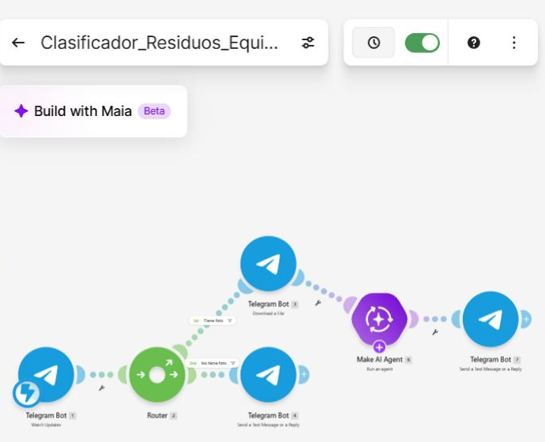

| # | Módulo | Función |
|---|--------|---------|
| 1 | **Telegram Bot – Watch Updates** | Disparador instantáneo (webhook). Recibe cada mensaje que llega al bot *Clasificador Residuos Equipo #*. |
| 2 | **Router** | Separa los mensajes con foto de los mensajes de solo texto. |
| 3 | **Telegram Bot – Download a File** | Descarga la foto. File ID: `{{last(map(1.message.photo; "file_id"))}}`. Telegram envía cada foto en varios tamaños y `last()` toma la de mejor calidad. |
| 4 | **Make AI Agent – Run an agent** | Conexión *Make's AI Provider* (modelo GPT-5 nano). En **Input files** recibe la foto descargada (`3.fileOutput` y `3.fileName`) y en **Input** el texto *"Clasifica el residuo de la imagen."* |
| 5 | **Telegram Bot – Send a Text Message or a Reply** | Chat ID: `Message → Chat → ID` (de Watch Updates). Text: la respuesta del AI Agent (`6.response`). |
| 6 | **Telegram Bot – Send a Text Message or a Reply** | Si llega un mensaje sin foto, le pide al usuario que mande la foto de un residuo. |

### Filtros

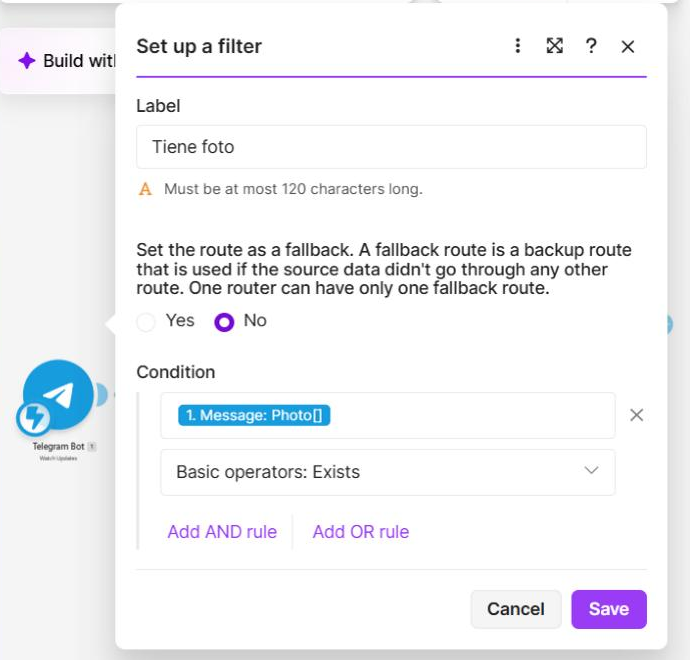

| Ruta | Nombre del filtro | Condición | Resultado |
|------|-------------------|-----------|-----------|
| 1st | **Tiene foto** | `Message → Photo` → *Exists* | Descarga la foto → IA → respuesta con la clasificación |
| 2nd | **No tiene foto** | `Message` *Exists* **y** `Message → Photo` *Does not exist* | Mensaje: "📸 Envíame la foto de un residuo…" |

Así la IA **solo se ejecuta cuando llega una foto**, y los mensajes de texto no gastan créditos de IA.

### Instrucciones del agente

Son las del documento de la práctica. Se agregó un párrafo para que la IA no invente objetos y, si en la foto hay varios residuos, clasifique el principal y mencione los demás en el consejo:

```
Eres un asesor de separación de residuos para alumnos de Desarrollo Sustentable del TecNM en Mazatlán, Sinaloa.
Recibirás la foto de un residuo. Responde en texto plano (sin asteriscos, sin markdown), en español, con este formato:
Residuo: [qué es]
Material: [material principal]
Clasificación: [orgánico / inorgánico reciclable / inorgánico no reciclable / manejo especial o peligroso]
¿Se recicla?: [sí / no / depende, con una línea de explicación]
Dónde va: [contenedor o lugar de acopio]
Tiempo aproximado de degradación: [tiempo]
Consejo: [1 línea para reducir o reutilizar este residuo]
Antes de responder, observa bien toda la imagen y describe solo lo que realmente se ve; no inventes objetos que no
aparezcan. Si en la foto hay varios residuos distintos, identifica el que ocupa el centro o la mayor parte de la imagen
y, en la línea Consejo, menciona brevemente los demás que veas y que conviene separar por material.
Si la imagen no muestra un residuo o no se distingue, responde: "No pude identificar el residuo, envía otra foto más clara."
Si es un residuo peligroso (pilas, medicamentos, aceite, químicos), indícalo y recomienda no tirarlo a la basura común.
```

> **Seguridad:** el token del bot **no** está en este repositorio. El `blueprint.json` solo guarda el número interno de la conexión de Make, no el token.

## 5. Pruebas con 10 residuos

Se fotografiaron 10 residuos de la casa y del campus y se enviaron al bot. La pila no se manipuló y no se incluyó en las pruebas.

| | | |
|:-:|:-:|:-:|
| 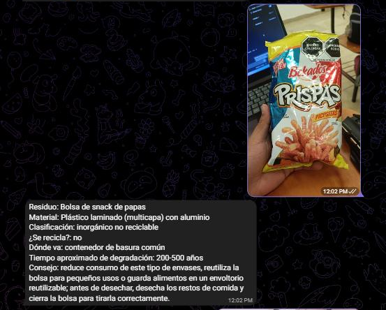 | 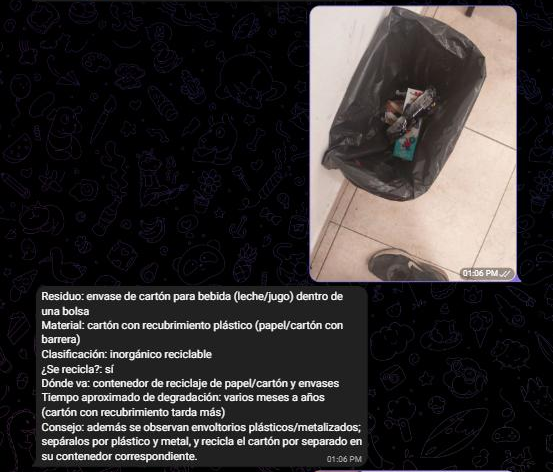 | 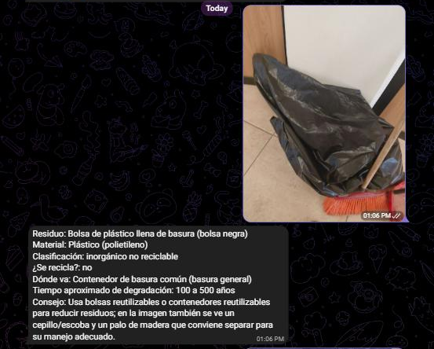 |
| 1. Bolsa de frituras | 2. Tetrapak en el bote | 3. Bolsa de basura |
| 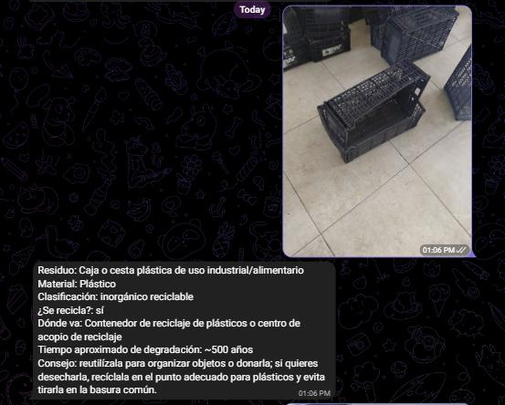 | 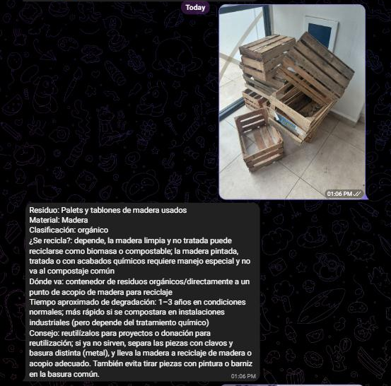 | 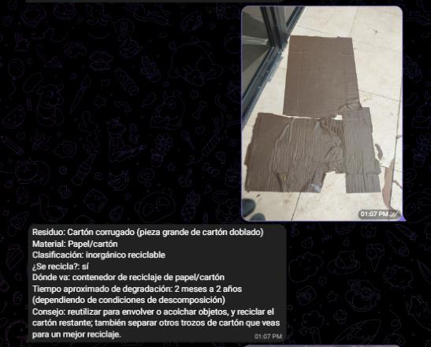 |
| 4. Caja de plástico | 5. Cajas de madera | 6. Cartón |
| 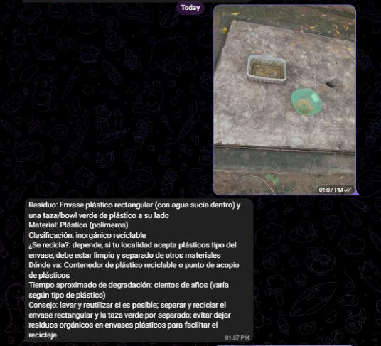 | 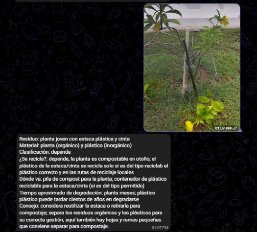 | 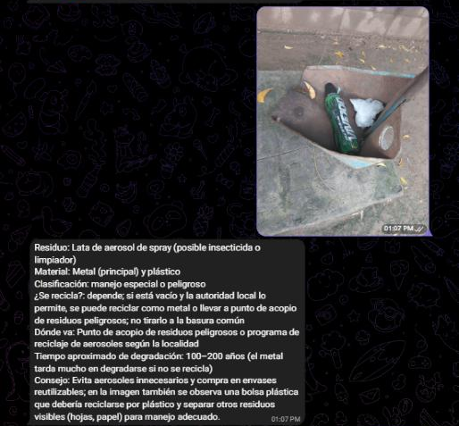 |
| 7. Envase de plástico | 8. Planta con estaca | 9. Lata de aerosol |
| 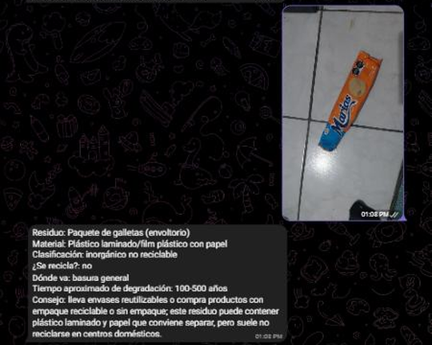 | | |
| 10. Envoltura de galletas | | |

### Verificación contra fuentes

Se revisaron 3 datos de cada respuesta: clasificación, si se recicla y tiempo de degradación.

| # | Residuo | Clasificación según la IA | ¿Correcta? | Tiempo según la IA | Tiempo según la fuente | Fuente |
|---|---------|---------------------------|:----------:|--------------------|------------------------|--------|
| 1 | Bolsa de frituras (plástico metalizado) | Inorgánico no reciclable | ✅ Sí | 200–500 años | 150 años (bolsa de plástico) | SEP; UnoTV/Semarnat |
| 2 | Envase tetrapak | Inorgánico reciclable | ✅ Sí | "Varios meses a años" | 30 años | SEP |
| 3 | Bolsa de plástico negra con basura | Inorgánico no reciclable | ✅ Sí* | 100–500 años | 150 años | SEP |
| 4 | Caja de plástico rígido | Inorgánico reciclable | ✅ Sí | ~500 años | 100–1000 años (plástico) | SEP |
| 5 | Cajas de madera | Orgánico | ✅ Sí | 1–3 años | No se encontró un dato oficial; depende del tratamiento de la madera | LGPGIR (art. 18) |
| 6 | Cartón | Inorgánico reciclable | ✅ Sí | 2 meses a 2 años | ~1 año (papel y cartón) | SEP; UnoTV/Semarnat |
| 7 | Envase de plástico | Inorgánico reciclable | ✅ Sí | Cientos de años | 100–1000 años | SEP |
| 8 | Planta con estaca de plástico | "Depende" (no usó ninguna categoría) | ❌ No | "Meses" / cientos de años | No aplica: es una planta viva, no un residuo | — |
| 9 | Lata de aerosol | Manejo especial o peligroso | ✅ Sí | 100–200 años | 200–500 años (envase de aerosol) | LGPGIR; Univision |
| 10 | Envoltura de galletas | Inorgánico no reciclable | ✅ Sí | 100–500 años | 150 años (bolsa de plástico) | SEP; UnoTV/Semarnat |

\* La bolsa de polietileno limpia sí se puede reciclar, pero una bolsa sucia y llena de basura no se recicla en la práctica.

**Resultados:**
- **Clasificación correcta: 9 de 10 = 90 %.**
- **Tiempo de degradación:** se pudo comparar en 8 residuos (la madera no tiene dato oficial y la planta no es un residuo). Coincidió con la fuente en 5 de 8. En la bolsa de frituras dio más tiempo que la fuente (200–500 contra 150 años), en el aerosol apenas tocó el límite inferior (100–200 contra 200–500 años) y en el tetrapak dio un tiempo muy corto y vago.
- **Créditos:** según el historial del escenario, **cada foto consumió entre 4.32 y 4.57 créditos (≈ 4.4 en promedio)** y 4 operaciones, con una respuesta en 5 a 11 segundos.

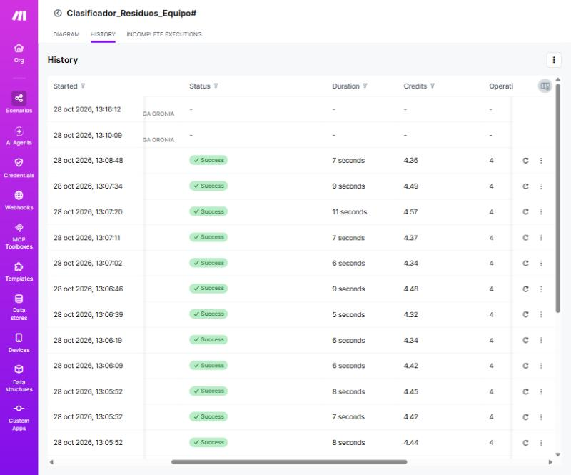

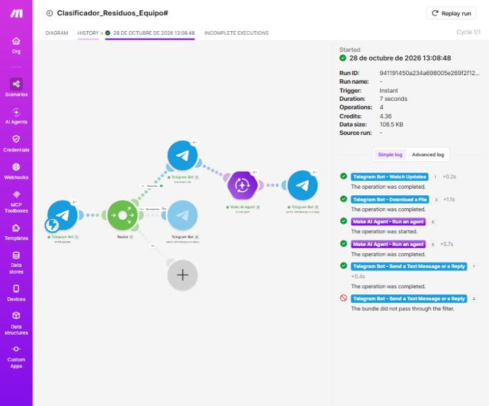

**Video de la prueba en vivo:** [▶️ Ver video en YouTube](ENLACE_YOUTUBE)

## 6. Retos y soluciones

- **`invalid file_id`:** la fórmula `{{last(1.message.photo).file_id}}` del documento marcó el error `[400] Bad Request: invalid file_id` y Make apagó el escenario. Se cambió por `{{last(map(1.message.photo; "file_id"))}}`, que saca la lista de `file_id` y toma el último, el de mejor calidad.
- **"No pude identificar el residuo":** en el primer intento la IA contestaba eso con todas las fotos porque en *Input files* se mapeó `3.data`. Se corrigió mapeando `3.fileOutput` (los datos del archivo) y `3.fileName`.
- **Varios residuos en una foto:** la IA a veces mencionaba objetos de fondo. Se agregó a las instrucciones que clasifique el residuo principal y mencione los demás en el consejo.
- **Límite de 2 escenarios activos:** el plan de Make solo permite 2 escenarios encendidos, así que se apagaron los de prácticas anteriores.

## 7. Preguntas de reflexión

**1. ¿Cuántos de los 10 residuos se pueden reciclar o compostar? ¿Cuántos separan realmente en su casa?**
De los 10 residuos, 5 se pueden aprovechar. Se reciclan el tetrapak, la caja de plástico, el cartón y el envase de plástico, y la madera sin pintar se puede reutilizar o compostar. La lata de aerosol solo se recicla como metal si está vacía y se lleva a un centro de acopio. Las bolsas de frituras y galletas y la bolsa de basura no se reciclan. En mi casa no separamos nada: todo va a la misma bolsa. Eso significa que hasta la mitad de lo que tiramos pudo aprovecharse y terminó en el basurón municipal de Mazatlán. Además, el camión de Aseo Urbano revuelve los residuos, así que la separación tiene que empezar en la casa.

**2. ¿Qué residuo les sorprendió más por su tiempo de degradación? ¿Qué impacto tiene al llegar al mar o a un canal de Mazatlán?**
Lo que más me sorprendió fueron las envolturas de frituras y galletas. Las usamos unos minutos, pero tardan de 100 a 500 años en degradarse y además no se reciclan porque son de plástico y aluminio pegados. Por ser ligeras, el viento y la lluvia las arrastran fácilmente a las calles y de ahí a los canales pluviales. En los canales tapan el paso del agua y provocan encharcamientos en temporada de lluvias. Cuando llegan al mar se rompen en microplásticos que comen peces, aves y tortugas, y además ensucian las playas, de donde la Operadora de Playas retira entre 200 y 300 kg de basura cada día.

**3. ¿En qué casos se equivocó la IA? ¿A qué se debió (foto, material mezclado, falta de contexto local)?**
En la clasificación se equivocó con la planta con estaca. Contestó "depende" en lugar de usar una de las cuatro categorías, y no se dio cuenta de que una planta viva no es un residuo. Esto pasó por la **foto**, porque había varias cosas mezcladas (planta, estaca, cinta y hojas), y porque la IA trata de clasificar todo lo que ve. En los tiempos de degradación falló con el tetrapak, al que le dio "meses a años" cuando son unos 30 años, y con el aerosol, donde se quedó en el límite más bajo. Eso se debe a que es un **material mezclado** (cartón, plástico y aluminio en el tetrapak; metal y gas en el aerosol). También se notó la **falta de contexto local**: varias veces respondió "según tu localidad" porque no sabe que en Mazatlán no hay recolección separada y todo llega al mismo basurón.

**4. ¿De quién es la responsabilidad de que un residuo se recicle: ciudadano, municipio o empresa fabricante?**
Es una responsabilidad compartida, y así lo dice la LGPGIR con el principio de responsabilidad compartida. El ciudadano debe separar en casa y llevar lo reciclable o peligroso a un centro de acopio. El municipio debe recolectar por separado, tener centros de acopio y cerrar el basurón para operar un relleno sanitario. La empresa fabricante debe diseñar empaques que sí se puedan reciclar y hacerse cargo de ellos al final de su vida útil. Creo que la mayor responsabilidad la tiene la empresa: si una bolsa de frituras está hecha de capas que no se pueden separar, por más que el ciudadano la separe, nunca se va a reciclar.

**5. ¿Qué cambio concreto harían en su consumo?**
Voy a dejar de comprar frituras y galletas en bolsas individuales y las voy a comprar en paquetes grandes o a granel, guardándolas en un recipiente reutilizable. También voy a llevar mi propia botella de agua al Tecnológico para no comprar botellas. En mi casa vamos a empezar con dos botes, uno para orgánicos y otro para reciclables (cartón, plástico y latas limpias), y vamos a llevar lo reciclable a un centro de acopio. Además, voy a reutilizar las cajas de madera y de plástico en lugar de tirarlas.

## 8. Relación con los ODS

- **ODS 12 – Producción y consumo responsables:** separar, reducir y reciclar residuos.
- **ODS 14 – Vida submarina:** evitar que los plásticos lleguen al mar de Mazatlán.
- **ODS 11 – Ciudades y comunidades sostenibles:** canales limpios y mejor manejo de la basura municipal.

## 9. Conclusión

El clasificador demostró que con Make y un agente de IA con visión se puede construir en poco tiempo una herramienta útil para separar residuos: acertó en el 90 % de las clasificaciones con un costo de unos 4.4 créditos por foto. Sin embargo, la verificación mostró que la IA puede dar tiempos de degradación vagos o equivocados y confundirse cuando hay varios objetos en la foto. Por eso sus respuestas siempre se deben revisar contra fuentes oficiales. La práctica también me dejó claro que el problema de la basura en Mazatlán empieza en la casa: si no separamos, ni la mejor tecnología puede evitar que los residuos terminen en el basurón, en un canal o en el mar.

## 10. Fuentes

- Ley General para la Prevención y Gestión Integral de Residuos (LGPGIR): https://www.diputados.gob.mx/LeyesBiblio/pdf/LGPGIR.pdf
- NOM-161-SEMARNAT-2011 (residuos de manejo especial), DOF: https://sidof.segob.gob.mx/notas/docFuente/5286505
- UnoTV – Residuos reciclables y no reciclables (Semarnat): https://www.unotv.com/cultura/residuos-reciclables-o-no-reciclables-asi-puedes-distinguirlos-y-separar-la-basura/
- SEP, Nueva Escuela Mexicana – Degradación de desechos orgánicos e inorgánicos: https://nuevaescuelamexicana.sep.gob.mx/contenido/coleccion/degradacion-de-desechos-organicos-e-inorganicos/
- Univision – Tiempo que demoran los residuos en descomponerse: https://www.univision.com/explora/no-podras-creerlo-este-es-el-tiempo-que-demoran-algunos-de-nuestros-residuos-en-descomponerse
- Luz Noticias – 700 toneladas de basura al día en Mazatlán: https://www.luznoticias.mx/2021-12-21/sinaloa/hay-alrededor-de-700-toneladas-de-basura-al-dia-en-mazatlan-morales-lizarraga/130988
- Luz Noticias – Campaña de separación de basura en Mazatlán: https://www.luznoticias.mx/2020-11-28/sinaloa/implementaran-campana-de-separacion-de-basura-en-mazatlan/104333
- Luz Noticias – Cierre del basurón municipal: https://www.luznoticias.mx/2024-02-27/sinaloa/cierre-del-basuron-municipal-y-abrir-un-nuevo-relleno-sanitario-costara-mas-de-150-millones-/196908
- Luz Noticias – Incendio en el basurón de Mazatlán (2026): https://www.luznoticias.mx/2026-07-03/sinaloa/controlan-nuevo-conato-de-incendio-en-el-basuron-de-mazatlan-sofocamiento-de-incendio-inicial-alcanza-hasta-95/295566
- Tus Buenas Noticias – Centros de acopio en Sinaloa: https://tusbuenasnoticias.com/medio-ambiente/recicla-tu-basura-en-los-centros-de-acopio-en-sinaloa/
- Luz Noticias – Basura en calles y canales de Mazatlán: https://www.luznoticias.mx/2023-07-09/sinaloa/ecologia-multara-a-quien-tire-basura-y-desechos-en-calles-y-canales-de-mazatlan/170178
- Luz Noticias – Desazolve de canales (2026): https://www.luznoticias.mx/2026-05-16/sinaloa/mazatlan-se-prepara-para-las-lluvias-con-limpieza-y-desazolve-de-canales/289574
- Luz Noticias – Playas de Mazatlán con problemas de basura: https://www.luznoticias.mx/2021-08-11/sinaloa/playas-de-mazatlan-con-serios-problemas-de-basura-oap/121981
- National Geographic – La ruta del plástico (datos del PNUMA 2021): https://www.nationalgeographicla.com/medio-ambiente/2022/04/la-ruta-del-plastico-del-bote-de-basura-a-los-ecosistemas-marinos
